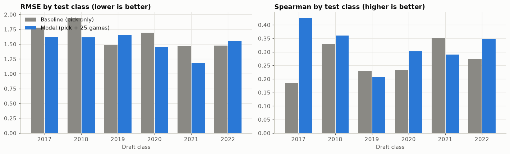
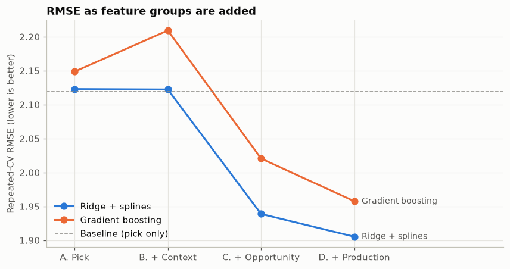
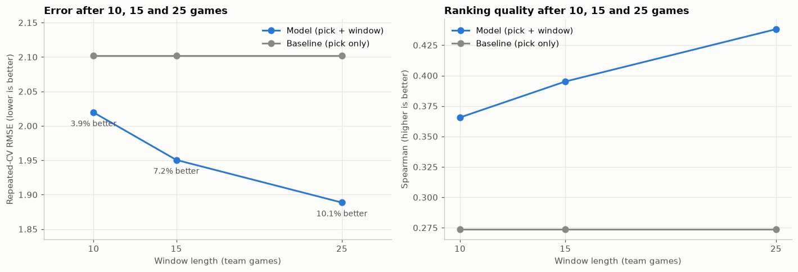
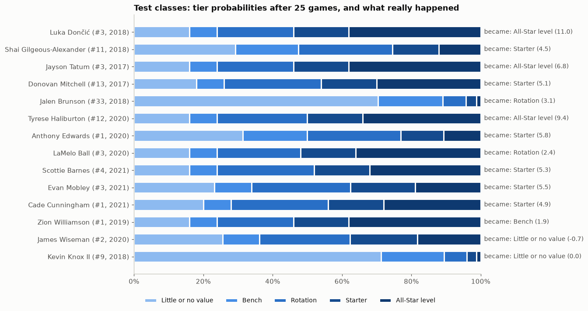
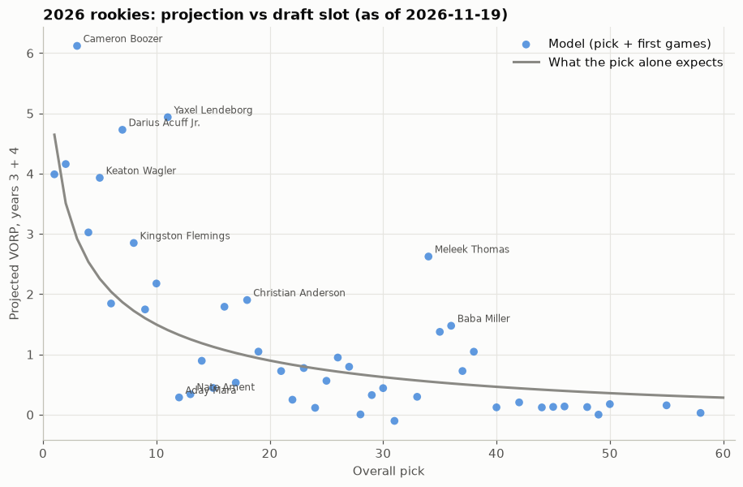

# Rookie Projection

**Can you predict an NBA rookie's future from his first two months in the league?**

Partly, yes. A rookie's first 25 games carry real information about his value in
years 3 and 4 that his draft position alone doesn't have. On draft classes the
model had never seen (2017-2022), adding those games cut the prediction error by
**8%** and improved the ranking of players by **~30%** compared with using the
draft pick alone. Most of that signal is **how much the coach plays him**, and it
builds up game by game: about 40% of it is there after 10 games, 70% after 15.

It is not a crystal ball. Twenty-five games can flag who is likely to outplay his
draft slot, but they can't tell an All-Star from a superstar, and they can't see
quiet starters who explode later (Jalen Brunson, Draymond Green).

---

## The question

Teams draft on scouting and college data, then get two months of NBA games before
they have to start making real decisions (rotation, development, trades). This
project asks whether those first games tell us something about a player's
**value in years 3-4** that his **draft position** didn't already say.

- **Target:** VORP (value over replacement player) summed over the player's 3rd and
  4th seasons. It combines quality and playing time, so busts and players who left
  the league score ~0 automatically.
- **Baseline to beat:** a model that only knows the draft pick.
- **Population:** every player drafted 2000-2022 who played in the NBA, aged 25 or
  younger at debut (1,180 players). Players who left the league stay in the data
  (no survivorship bias).

## Data

| Source | What | How |
|---|---|---|
| `nba_api` (stats.nba.com) | draft history, every regular-season game log 1999-00 to 2025-26 | ~55 requests, one per season and mode, cached |
| Basketball-Reference, via the [Kaggle mirror](https://www.kaggle.com/datasets/sumitrodatta/nba-aba-baa-stats) (CC0) | season VORP, BPM, minutes, age | basketball-reference.com blocks scrapers, so the public mirror was used and validated against known values |

NBA and Basketball-Reference ids are linked through the draft (year + name, then
year + pick, with one manual fix).

## Approach

**The early window.** For each rookie: the 25 games of his team starting from his
NBA debut (so draft-and-stash players and injured rookies are handled the same way).
Nothing after that window is used, so there is no leakage from the future.

**Features (22).**
- *Opportunity:* minutes per game, share of games played, total minutes
- *Production:* 14 rate stats (TS%, usage, points/assists/steals/blocks per 36,
  rebound %, 3PA and FT rates, turnover %, +/-)
- *Context:* age at debut, years between draft and debut, team win %
- *Pick:* log(pick) and log(pick)², the baseline's own curve

Two details that matter with small samples:
- **Era adjustment:** every rate stat is measured relative to the league that
  season (league 3PA rate went from 17% to 41% between 2000 and 2025).
- **Shrinkage:** each stat is pulled toward the average rookie in proportion to how
  little evidence there is. A center who goes 2/2 from three in 12 minutes gets an
  average-rookie 3P%, not 100%.

**Model.** An ensemble averaging a Ridge regression with spline terms and a gradient
boosting model, chosen against plain Ridge and boosting alone.

**Validation.**
- *Development:* classes 2000-2013, repeated cross-validation grouped by draft class
  (25 paired splits), used for every choice.
- *Final test:* walk-forward on 2017-2022. Each test class gets its own model trained
  only on players whose year 4 had finished before that class's rookie season. The
  model was frozen before the test ran.

## Results

### 1. The first games beat the pick, on players the model never saw

| | Pick only | Pick + first 25 games |
|---|---|---|
| **Test** RMSE (2017-2022, 331 players) | 1.65 | **1.52** (−8%) |
| **Test** Spearman (ranking) | 0.26 | **0.33** |
| Cross-validation RMSE (2000-2013) | 2.10 | **1.89** (−10%) |
| Cross-validation Spearman | 0.27 | **0.44** |

The model is better in 4 of the 6 test classes, and better in 94% of bootstrap
resamples of the test players (90% range of the gain: −0.01 to +0.27): strong but
not airtight evidence.



The biggest gain is in **ranking players picked in similar spots**: among picks
11-30, the pick alone has essentially no ranking power (Spearman 0.05 on the test);
the model reaches 0.35. On second-round picks the model doesn't help.

### 2. The signal is mostly the coach's trust

Adding feature groups one at a time (cross-validation):



Minutes and games played bring ~85% of the improvement; what the rookie does with
those minutes (efficiency, playmaking, rebounding) adds a smaller extra; age and
team context add nothing beyond the pick. Coaches see their rookies every day in
practice, and early minutes summarise that judgement. Within the box score, assists
and steals per 36 carry the most signal; shooting efficiency over 25 games is too
noisy to matter.

### 3. How early does it appear?



| Window | Gain over the pick | Splits where it wins |
|---|---|---|
| 10 games (~3 weeks) | 3.9% | 19 / 25 |
| 15 games (~1 month) | 7.2% | 21 / 25 |
| 25 games (~2 months) | 10.1% | 24 / 25 |

The answer to "how long should you wait before reading anything into a rookie":
after a month there is real signal; after two months it is reliable; and it hadn't
levelled off at 25 games, so waiting longer likely helps further.

### 4. From one number to probabilities

A single predicted VORP is an average of many futures, so it is always cautious.
Instead, each player gets **tier probabilities**: among historical players with a
similar projection, how many became bench players, starters, All-Star-level players.
These hold up on the test (Brier score 0.51 vs 0.53 for pick only), along with a
floor-to-ceiling range and "plays like" comparables.



What the frozen model said after 25 games, on the test classes:

| Player | Pick | Pick alone expected | Model | P(All-Star level) | What happened |
|---|---|---|---|---|---|
| Tyrese Haliburton | 12 | 1.3 | 5.0 | 34% | 9.4, All-Star level |
| Luka Dončić | 3 | 3.0 | 6.1 | 38% | 11.0, All-Star level |
| Jayson Tatum | 3 | 3.2 | 6.9 | 38% | 6.8, All-Star level |
| Markelle Fultz | 1 | 5.2 | 2.2 | 8% | 0.0, bust |
| Jalen Brunson | 33 | 0.6 | 0.5 | 1% | 3.1, rotation (missed) |
| Anthony Edwards | 1 | 5.0 | 2.7 | 11% | 5.8, starter (too low) |

**Superstars.** Only 8 players in 23 drafts reached superstar level (VORP ≥ 10 over
years 3-4: LeBron, Wade, Chris Paul, Brandon Roy, Durant, Jokić, Towns, Luka), too
few for a reliable per-player probability, so there is no "superstar" tier. But they
do surface at the top: 4 of the 5 in the development set were among the model's 50
highest projections. A rookie in that group is about **11 times** as likely to become
a superstar as the average rookie (8% vs 0.7%), even though the model can't say
*which* of them it will be.

**Every card is saved.** [`reports/cards_history.md`](reports/cards_history.md) has a
card for all 1,180 rookies from 2000-2022: what the system would have said after
their first 25 games (always from a model that never saw them) and what really
happened. [`reports/cards_2026_class.md`](reports/cards_2026_class.md) has the
current class. Both are also saved as CSV in `data/processed/`.

### 5. Applied to the 2026 class (preview, as of 19 Nov 2026)



With ~15 games played (so using the 15-game version of the model, retrained on every
class from 2000-2022): Cameron Boozer (#3) projects highest (40% All-Star level);
Yaxel Lendeborg (#11) is the biggest early riser over his draft slot; Darius Acuff Jr.
(#7) projects well but carries the "heavy minutes on a weak team" warning, a profile
the model has historically over-projected.

## Limitations

- **"Empty minutes."** Rookies who play a lot because their team is rebuilding
  (Michael Carter-Williams, Dennis Smith Jr., RJ Barrett) are over-projected. Eight
  team-context and "empty volume" features were tested to fix it and rejected; the pattern is real but
  only ~60 players in history show it. It is shown as a warning on the player cards
  instead, with its historical error.
- **Era drift.** Recent classes reach lower VORP for the same early profile (minutes
  are spread across more players: year-3 minutes fell from ~1,050 to ~900), so the
  model trained on older classes runs a bit optimistic on recent ones.
- **The top end.** Too few players were ever projected as high as LeBron, Chris Paul
  or Derrick Rose for the data to tell them apart; all sit around 36-40% All-Star.
  With only 8 superstars since 2000, the model can say who is in the group where
  superstars come from, not who will become one.
- **What 25 games can't see:** late bloomers, injuries in years 3-4, and changes of
  team or role after the window.
- The target is one number over two seasons; it mixes quality with availability.

## What I'd do next

- Extend the window study to 40 games and the full rookie season, to find where the
  signal levels off.
- Pre-season betting win totals as a cleaner "tanking team" signal for the
  empty-minutes problem.
- Re-run the 2026 projections at 25 games (mid-December) and track them over time.

## Repository

```
src/          data pipeline and shared modelling code
  fetch_draft.py, fetch_gamelogs.py, fetch_bbref.py, fetch_current_season.py
  build_rookie_window.py, build_target.py, build_features.py, build_current_features.py
  modelling.py (evaluation rules), models.py (final model), projection.py (tiers, comps)
  build_cards.py (player cards for every rookie)
notebooks/    01 EDA · 02 modelling · 03 interpretation · 04 team features (rejected)
              05 projections · 06 robustness · 07 empty minutes · 08 final test
              09 current rookies
figures/      charts used in this README
reports/      player cards: every rookie 2000-2022, and the current class
notes.md      full log of decisions, problems and findings
```

### Reproduce

```bash
python -m venv .venv && .venv\Scripts\activate     # Windows
pip install -r requirements.txt

python src/fetch_draft.py
python src/fetch_gamelogs.py
python src/fetch_bbref.py
python src/build_rookie_window.py
python src/build_target.py
python src/build_features.py
# robustness tables: build_rookie_window.py / build_features.py with --window 10 and 15
# current class: fetch_current_season.py, then build_current_features.py --window 15
python src/build_cards.py --window 15   # all player cards (25 once the rookies get there)
```

Then run the notebooks in order. Raw downloads are cached in `data/raw/` (not
committed); everything in `data/processed/` is regenerated by the scripts.

**Stack:** Python, pandas, scikit-learn, matplotlib, nba_api.
